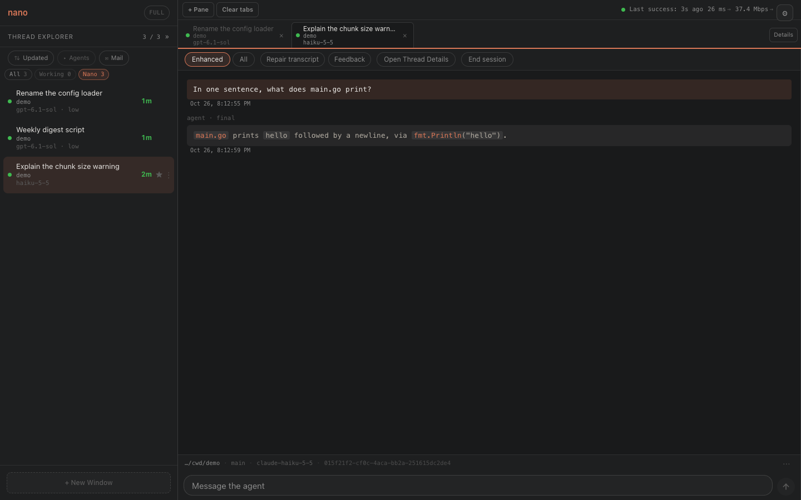

# nano

Nano is a local web app that runs coding-agent sessions from several providers
side by side. It drives Codex, Claude Code and, experimentally, Grok Build
through their own CLIs, shows every thread in one browser tab with the same
clean transcript, searches all your saved sessions at once, and gives agents an
HTTP API to start and talk to each other across providers.

Built for my own workflow. One maintainer, best effort. Developed privately
since 2026. Issues and pull requests are welcome.



## What it does

- **One interface for every provider.** Start, prompt, resume and stop Codex,
  Claude Code and Grok Build sessions from one page. Nano makes them look the
  same.
- **Clean transcripts.** The Enhanced view shows only user and agent messages.
  Tool calls and reasoning are one click away, not in your face.
- **Agents that work together.** Any hosted thread can create threads on any
  provider through the API, send them prompts, read their replies as plain
  messages, and leave them mail that does not interrupt a running turn. With
  `-heartbeat`, a thread can be woken on a schedule.
- **Search.** Full-text search over the saved Codex, Claude and Grok
  transcripts on the machine. Threads Nano hosts stay current on their own;
  sessions started elsewhere are picked up when you press Refresh in the
  Thread Explorer.
- **Every device.** An optional password-guarded listener lets you open the
  same page from your phone through a reverse proxy such as Tailscale Serve.

How Nano is built: [docs/architecture.md](docs/architecture.md). The rules
every change is held to: [docs/principles.md](docs/principles.md).

## Prerequisites

- macOS. Nano watches provider session files with kqueue and finds new ones
  with FSEvents; Linux is untested.
- Go 1.24 or later. Node: the latest 22.x, or newer. The locked web
  dependencies need at least 22.22.2 in the 22 line, 24.15 in the 24 line,
  or any 26. Older Node builds the bundle with a warning but fails the
  component tests.
- The [`codex`](https://github.com/openai/codex) CLI, signed in: run
  `codex login` once and check with `codex login status`. Nano drives it
  through `codex app-server`. A CLI that is installed but not signed in
  still starts a session, but every prompt fails upstream with HTTP 401.
- Optional: the `claude` CLI (Claude Code), signed in.
- Optional and experimental: the `grok` CLI with its native leader running
  (`grok agent --leader`). Nano connects to the leader's socket; it never
  starts one.

## Quick start

```sh
git clone https://github.com/dkroshow/nano.git
cd nano
npm --prefix web ci && npm --prefix web run build && go build -o nanod . && ./nanod
```

Open <http://127.0.0.1:7690/> and press **New Window** to start a session in
any directory. `./nanod -h` lists every flag.

The page loads without any provider CLI, but a session needs its CLI on
Nano's `PATH`. Without `codex`, a new Codex session sits at `starting` and
goes to `exited` after about 30 seconds with
`exec: "codex": executable file not found in $PATH`. Nano reads `PATH` at
startup, so restart it after installing a CLI.

The web bundle is compiled into the binary, so after a change under `web/`
rebuild both.

## Usage

**Run a second, isolated instance.** Every store, log and spool goes under
`-data-dir`, so a candidate build can run beside an installed one. The port
and data dir are not enough on their own: the Codex app server and the
Claude shim are shared processes on fixed ports, so a second instance must
also be given its own `-codex-ws` and `-claude-shim-ws` endpoints (and its
own `-grok-leader-socket` if it uses Grok), or it attaches to the installed
instance's providers. `-cwd` sets the default working directory for new
sessions; without it Nano keeps the directory it was launched from.

```sh
$ ./nanod -port 17790 -data-dir /tmp/nano-demo -cwd /tmp/nano-demo -usage=false \
    -codex-ws ws://127.0.0.1:17791 -claude-shim-ws ws://127.0.0.1:17792 \
    -codex-supervisor-label local.nano.demo.app-server
2026/10/27 08:59:24 persistent server log using /tmp/nano-demo/logs/server.log
2026/10/27 08:59:24 thread catalog using /private/tmp/nano-demo/history.sqlite
...
2026/10/27 08:59:25 nano listening on http://127.0.0.1:17790 (default cwd /tmp/nano-demo, codex daemon ws://127.0.0.1:17791, claude shim ws://127.0.0.1:17792, grok grok)
2026/10/27 08:59:25 boot re-attach finished: 0 threads in 0s (0 registered, 0 settled by a request, 0 failed, 0 no longer stored)
```

Nano starts its own `codex app-server` on the Codex port only when nothing
listens there and no launchd job with its `-codex-supervisor-label` is
loaded; with the installed label it waits for that job instead, whatever
the socket. So a second instance must also name a label that is not
installed, as above. With nothing on the shim port, its Claude sessions run
as direct children.

**Drive a session from a script.** The same routes the page uses. This
example needs `jq`. A session has two ids: Nano's session id, returned on
creation, and the provider's native thread id, which appears as `threadId`
once the provider has started and is what the transcript routes take.

```sh
# Start a Codex session in a repository
id=$(curl -s -X POST localhost:7690/api/sessions -H 'content-type: application/json' \
  -d '{"provider":"codex","mode":"start","cwd":"/path/to/repo","name":"Rename the config loader"}' | jq -r .id)

# Wait for the provider to start, then take the native thread id
for i in $(seq 1 30); do
  st=$(curl -s localhost:7690/api/sessions | jq -r --arg id "$id" '.sessions[] | select(.id == $id) | .status')
  [ "$st" = ready ] && break; sleep 1
done
thread=$(curl -s localhost:7690/api/sessions | jq -r --arg id "$id" '.sessions[] | select(.id == $id) | .threadId')

# Send a prompt. clientActionId is an idempotency key: reuse it and you get the first outcome back.
curl -s -X POST localhost:7690/api/sessions/$id/turn -H 'content-type: application/json' \
  -d '{"text":"Read main.go and tell me in one sentence what it prints.","clientActionId":"rename-1"}'
{"accepted":true,"clientActionId":"rename-1","confirmed":false,"pending":false,"reason":"","status":"accepted"}

# Read the thread as plain messages once the reply has landed in the saved transcript
curl -s "localhost:7690/api/v1/threads/$thread/messages?tail=10&format=text"
user [2026-10-27T03:34:09.54Z]
Read main.go and tell me in one sentence what it prints.

agent [2026-10-27T03:34:11.945Z]
I’ll read main.go and check what it prints.

agent [2026-10-27T03:34:14.303Z]
It prints `hello` followed by a newline.
```

Agents get the same API with identity and idempotency rules attached:
`GET /api/v1/capabilities` is the guide and `GET /api/v1/openapi.json` the
exact contract.

## What Nano reads, writes and sends

- **Reads your agent history and settings.** Nano reads the session files
  under `~/.codex`, `~/.claude` and `~/.grok` to list, show and search
  threads, and reads the instruction and settings files a session loads
  (`AGENTS.md`, `CLAUDE.md`, `.claude/settings.json` and their user-level
  copies) to show them in the inspector. It never writes under those three
  directories.
- **Reads and edits local text files.** A file reference in a transcript
  opens as a tab. Through those tabs and `/api/v1/files`, Nano reads any
  UTF-8 text file the server's user can read, by absolute path (`~` is
  expanded) or by a path relative to a thread's working directory, and can
  overwrite any existing text file it can reach, with mtime conflict checks;
  the instruction files a session loads are editable the same way. A save
  writes a temporary file beside the target and renames it over the
  original, so the file gets a new inode and a hard link to it is left
  behind. Writes must name a canonical absolute path: a path through a
  symlink is refused, and files under `~/.codex`, `~/.claude` and `~/.grok`
  stay view-only. Nano never creates new files of yours and never deletes
  any.
- **Reads your Claude login token and sends it to Anthropic.** With the
  default `-usage=true`, Nano reads the Claude Code OAuth access token from
  `~/.claude/.credentials.json` or the macOS Keychain and sends it to
  `https://api.anthropic.com/api/oauth/usage` every five minutes to show your
  usage limits in the page. This is the same undocumented call Claude Code's
  own `/usage` screen makes. Codex and Grok usage come from their local
  processes. `-usage=false` turns all of it off: no token read, no call, no
  usage store.
- **Drives agent sessions.** Nano creates and controls sessions through the
  provider CLIs: `codex app-server` for Codex, `claude -p` for Claude Code,
  and the Grok leader for Grok. Those processes run with the permissions the
  session asks for, in the working directory you choose. Nano's own defaults
  are permissive (`-sandbox danger-full-access`, `-approval never`); change
  them with the flags or per session in the New Window dialog.
- **State on disk.** Nano's internal state lives under `~/.nanod` unless
  `-data-dir` moves it: SQLite stores for the thread catalog, hosted threads,
  mail, heartbeat, stars, transcript pins, feedback notes, the remote
  listener's password and sessions, and usage; a server log under `logs/`;
  a restart log (`restarts.jsonl`); and `threads-backups/`, a copy of the
  hosted-thread store taken before each schema migration. A brand-new
  install runs its migrations on an empty database and so writes over a
  megabyte of such backups on first start. A transient wire spool for live
  sessions lives in `wire/` under the same directory: Nano empties it at
  startup and deletes each session's file when that session closes.
- **Network.** The server's usage check above, off with `-usage=false`, is
  the only network egress. The page in your browser makes no request of its
  own for transcript content: Markdown is rendered with raw HTML escaped and
  `javascript:` links dropped, and an image is rendered as a link, not
  fetched. Nano binds `127.0.0.1` only. The local API has no authentication, so anything on your
  machine that can reach the port can drive your sessions. The optional
  remote listener (`-remote-auth-port` with `-remote-auth-host`) is a second
  loopback port meant to sit behind a reverse proxy; it accepts one exact
  `Host`, requires a password you set at `http://127.0.0.1:7690/security`,
  and keeps a 30-day browser session. The same local page can also allow
  exact Tailscale logins to skip the password, trusting the identity header
  Tailscale Serve verifies and inserts; the list starts empty. Nano never
  opens that port to the network itself. Details and the trust boundary:
  [docs/decisions/password-protected-remote-access.md](docs/decisions/password-protected-remote-access.md).

## Keeping sessions across restarts

**Codex.** Sessions go through one `codex app-server` process on
`ws://127.0.0.1:7691`. If nothing is listening there, Nano starts one and it
exits with Nano. To keep Codex sessions alive across Nano restarts, run the
app server and Nano as launchd user agents. `tools/` holds templates for
both (`local.nano.app-server.plist`, `local.nano.server.plist`); edit the
paths, copy each to `~/Library/LaunchAgents/`, and load it with
`launchctl bootstrap gui/$(id -u) ~/Library/LaunchAgents/<label>.plist`.

**Claude Code.** Sessions are `claude -p` children. They survive a Nano
restart only through the shim in `cmd/claude-shim`, which must already be
running when Nano starts the session; if Nano cannot reach it, Nano logs a
warning and spawns the child directly, and that session ends with Nano.
Neither template starts the shim. Run it yourself, with a spool directory
under the same data dir Nano uses:

```sh
go build -o claude-shim-bin ./cmd/claude-shim
./claude-shim-bin -listen 127.0.0.1:7692 -spool-dir ~/.nanod/claude-shim/spools
```

Grok Build support is experimental and needs the leader you install yourself;
see [docs/decisions/grok-native-leader.md](docs/decisions/grok-native-leader.md).

## Development

```sh
npm --prefix web run dev   # UI loop on http://localhost:5173, proxied to a running nanod on :7690
go test ./...
npm --prefix web test
```

[AGENTS.md](AGENTS.md) has the conventions and the check to run before a
commit.

## License

MIT. Copyright (c) 2026 Kenny Diekroeger. See [LICENSE](LICENSE).
